This has to be ragebait, right? With the amount of awful cookie cutter games released over the past 12 months, 2026 is shaping up to be the year of AI slop.

But how would you feel if I told you that yes, we're being inundated with low quality games in huge volume, but it's actually an important stepping stone for the game development industry as a whole? And that, like many of the foundational technological leaps of the past 100 years, we'll come to adapt and use AI assistance in a way that will eventually create some of the greatest games yet to be released? Yes, it's a spicy take, but hear me out on this one.

I've been in software development for over 10 years and I've seen it from both sides. It's important to take on board opinions that challenge our conventional wisdom. And I hope you'll at least see how AI models have already fundamentally changed game development, and that they offer an opportunity to unlock more creativity than ever before.

I originally sat down to write about the case for and against AI in game development. By the time I'd finished just the arguments for it, I was already at almost 2,000 words. So I've split it in two, and this is the case for the defence. And remember, it's perfectly fine to disagree with each other.

## Democratising game development

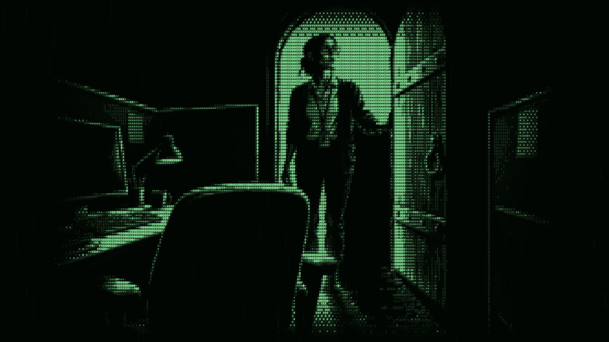

Let's start with the big one. AI coding has democratised game development. I'd say we're not quite at the point where anybody can create any piece of software imaginable.

But what AI coding has done is take a process that used to be highly skilled and complex, and simplify it massively. And that lowers the bar to entry, a lot. You could argue that's a bad thing.

But let's generalise AI coding for a moment and think of it as yet another creative avenue. That's exactly why I got into software development over 10 years ago. I'd found something that let me express my creativity. My older brother is the musically gifted one.

So why would we actively fight something that opens those tools up to more people than ever before? And yes, there are more games than ever. Steam had just over 10,000 new releases in 2020. In 2025 that number was around 20,000, a record.

On top of that, research from Totally Human found that roughly 1 in 5 games released on Steam in the first half of 2025 disclosed using generative AI in some way. That's an 800% increase in disclosures on the year before.

But nearly half of the games released on Steam in 2025 got fewer than 10 user reviews. PC Gamer went through SteamDB's data in December and found more than one in ten games released that year hadn't been reviewed at all. Players aren't rewarding slop, they're ignoring it.

Chris Zukowski, who runs How To Market A Game, actually went digging through the 2025 data to find the AI flood everyone was worried about. His conclusion? It never came. Release growth in 2025 was one of the slowest years since Steam opened its doors to everyone with Steam Direct back in 2017.

## The industry hasn't caught up

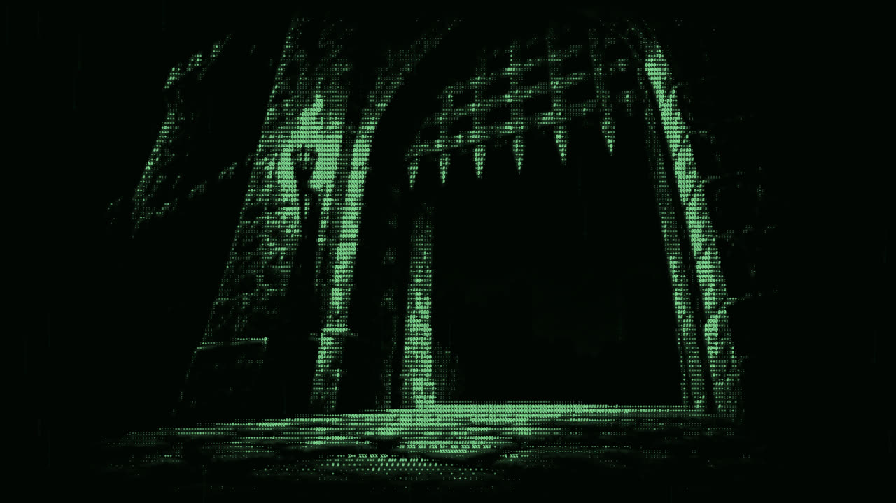

So why does it feel so bad right now? I'd argue the real issue is that the bar for quality hasn't been properly maintained. Players are being exposed to games that, in the past, would never have been considered acceptable to put on a storefront.

Back in January 2024, Valve changed its rules so that it could release the vast majority of games that use AI on Steam. As long as you fill in a disclosure and nothing is illegal or infringing, you're pretty much good to go.

Now compare that to GOG. Every single game that ends up on GOG is reviewed by a human, then debated and voted on by their business development team before it's put in front of players to buy. So do you think GOG has a problem with AI slop? No, no it doesn't.

And yes, I know GOG got some stick at the start of this year for using an AI generated banner in one of its sales. But that's their marketing, not the games on their store.

To be fair, GOG's managing director said this year they're not planning on making absolute statements in either direction on AI, and that in some contexts it genuinely helps them. The point still stands, though. A proper quality gate keeps the slop out.

## Like CGI

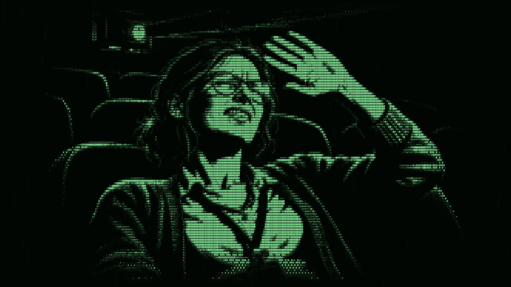

I like to compare AI development to CGI when it first really became commonplace in Hollywood films. I remember the amount of fervour and frothiness at the time around terrible CGI. Cough cough, Indiana Jones and the Kingdom of the Crystal Skull, cough.

Everyone was up in arms about the move away from practical effects towards cheap mo-cap action scenes and, of course, a fridge surviving a nuclear blast. I've got two questions for you though. Did practical effects survive? And did studios get any better at CGI?

The answer to both is yes. Practical effects never went away, and in fact they're held in even higher regard now in the era of CGI. And studios spent years massively upskilling their effects teams to produce seamless, highly blended special effects.

And it still happens today, you just don't notice it. Take Top Gun: Maverick. It was sold to us as this incredible, practical, real-jets-in-the-sky movie. And it was, partly. But it also had around 2,400 visual effects shots, including digitally re-skinning the jets.

The film's effects team told Oscar voters that some jets were replaced in post because the actors couldn't be filmed in the right aircraft. That included the Navy's F-14, which was retired in 2006.

Barbie, another film praised for its practical sets, had around 1,300 visual effects shots. Did you notice? Probably not. There's a brilliant YouTube series by a VFX supervisor called Jonas Ussing that covers this, and the title says it all. "No CGI" is really just invisible CGI.

The point I'm making is this. When it's done well, nobody can tell. When it's done badly, it's painfully obvious. And I'd argue AI in game development is heading the exact same way. The slop you're seeing right now is the Crystal Skull era. The good stuff is already out there, you just haven't noticed it.

## Back to the bedroom

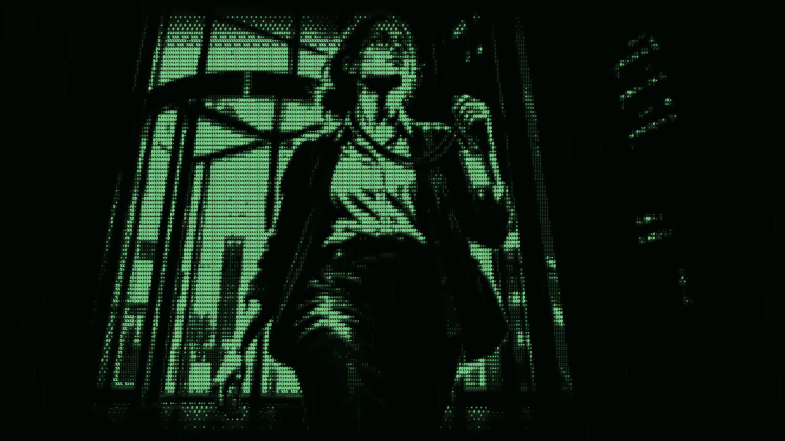

This next one is close to my heart. I'd argue AI wrestles control away from the monolithic gaming industry and puts it back to its roots.

Most people aren't old enough to remember just how much of a cottage industry video game development was back in the 80s and 90s. Here in the UK we even had a name for them. Bedroom coders.

Single person developers chipping away at something in their spare time whilst holding down a dead-end job. It's the founding story of a lot of the most famous veteran game developers of the 20th century.

Take Chris Sawyer. He made RollerCoaster Tycoon from his home near Glasgow, and wrote 99% of the code himself, in assembly language of all things. It went on to be the top-selling PC game of 1999. One guy.

Back then developing games wasn't easy, for sure, but there were a lot fewer moving parts. The technology and languages were far more primitive, but there also wasn't an endless list of requirements demanded of developers.

Fast forward to today and you could argue game development has gotten far too complex. So much so that it's turned away from its quirky, bedroom dwelling roots into a corporatised, efficient, money printing automaton.

Leaked documents from Insomniac showed that Marvel's Spider-Man 2 cost roughly $300 million to make. That's nearly triple what the first game cost, just five years earlier. And Bloomberg's Jason Schreier has since reported that the AAA budgets he's hearing about are now north of $300 million, and sometimes much more.

Because of the ever increasing demands of modern audiences, game development has become an unruly, complex beast that asks far more of a single developer than it ever did.

## Two ways to tame the beast

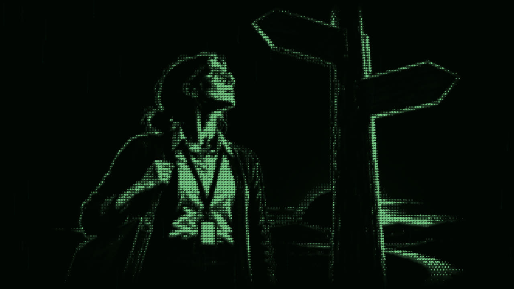

At these sorts of inflection points, where a job becomes so complex that it's potentially unmanageable for one person, there are usually two equally valid but very different solutions. You bring in more people to share the work, or you find better tools to make the work easier.

Indie developers don't have that first option. They can't hire more programmers, artists, composers, modellers or cloud architects. They're just expected to do it all.

Think about Stardew Valley. Eric Barone did the programming, the art, the music and the design himself. It took him over four years, with 70-hour weeks for years on end.

It's now sold over 50 million copies, and it's one of the greatest indie success stories of all time. But for every Eric Barone, how many people burned out and gave up before they ever shipped?

So when indie developers are handed technology that makes all of that a bit more manageable, is it really any surprise that so many jump at the opportunity?

## The genie is out

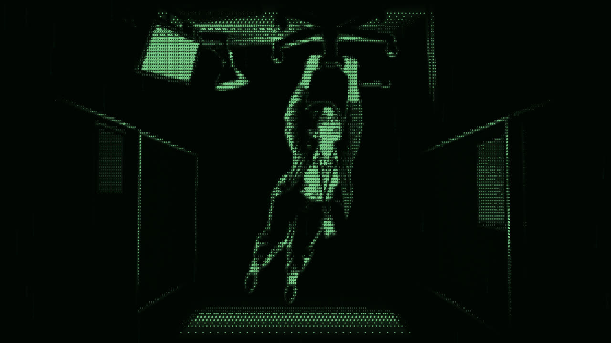

Regardless of what you think of AI tools and coding, I can honestly say as a software developer that the industry right now has been completely turned on its head.

In Stack Overflow's 2025 developer survey, 84% of developers said they were using or planning to use AI tools, and over half of professional developers were using them daily. And games are no different.

Just this week, a games consultancy called Vivrato published a report based on interviews with 101 senior studio leaders. 94% of them said AI is already used in at least one stage of their production.

I'll give you my personal take, as someone who's been grappling with my conscience on this one for quite some time. If I could snap my fingers and make it so LLMs were never invented, would I? 100% yes. Do I think that's realistic? Not in the slightest.

And I'm clearly not alone in feeling that way. In GDC's 2026 State of the Game Industry survey, 52% of game industry professionals said generative AI is having a negative impact on the industry. That's up from just 18% two years ago. People are using it and disliking it at the same time.

The problem is you can't put the genie back in the bottle. Because of AI coding models, a real and serious problem has formed across the industry that's hard to grapple with.

## No rest for the wicked

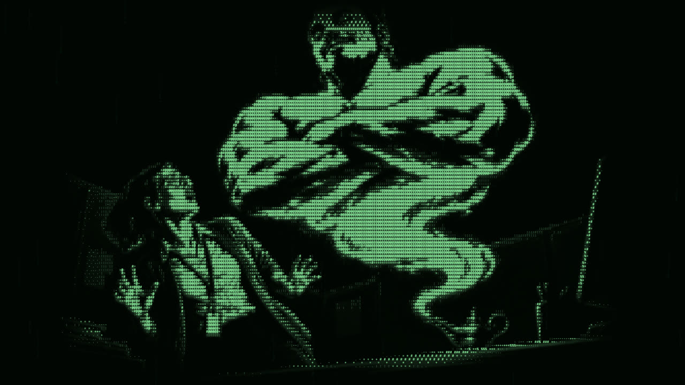

The expectation was that AI assistance would make coding easier, so developers would have more time to focus on the specific, very technical problems that often get overlooked. What's actually happened is that the boost from AI coding has rapidly increased the pace at which software is produced. There ain't no rest for the wicked.

Developers who've been very resistant to AI assisted coding have found themselves leapfrogged on productivity metrics by devs who jumped on the AI bandwagon. That's turned development into a competition of who can close the most tickets. Software engineering has essentially become a productivity race, with very little attention paid to the quality of the work.

The other problem is this. Engineers who don't use AI are finding it increasingly difficult to compete in an already brutal job market. The same GDC survey found that 28% of respondents had been laid off in the past two years.

Companies have their pick of the litter right now, and one of the first questions they ask is, "Can this engineer use AI tools effectively?" One developer in that GDC survey summed it up perfectly. "AI is theft. I have to use it, otherwise I'm gonna get fired."

## How it's used

Whether you think that's fair or not, the point is it's already happened. Big game development companies are already ten toes down on the AI train. Yet most of the hate is aimed at independent developers for trying to add AI assistance into their routine, sometimes ham-fistedly.

I don't want to put words into anyone's mouth, but anecdotally a lot of the blame I see pointed at "AI slop" games is actually about the brazen, extractive way AI is being used. Popular and successful games getting duped. Low effort, bottom of the barrel games making their way onto Steam. Games where there's clearly been zero attention to detail in the final product.

I don't disagree with you there, and it's only getting worse. A game called Needle In A Haystack Simulator went viral, and before it had even launched, at least eight copycat games with similar names and concepts had popped up on Steam.

The developer had to stamp the word "original" on their own store images just so players could tell which one was real. And just last week, indie studio Alliance Arts cancelled the public demo for their game Drunken Goddess Reflux, because they were worried it'd be cloned with AI tools and released before they could launch.

That's awful. But I'd argue it isn't a problem with AI coding itself. It's the same quality gate issue I talked about earlier. Copycats existed long before AI. What's changed is how fast they can be made, and storefronts that will let almost anything through are the ones letting them in.

## Take it up with them

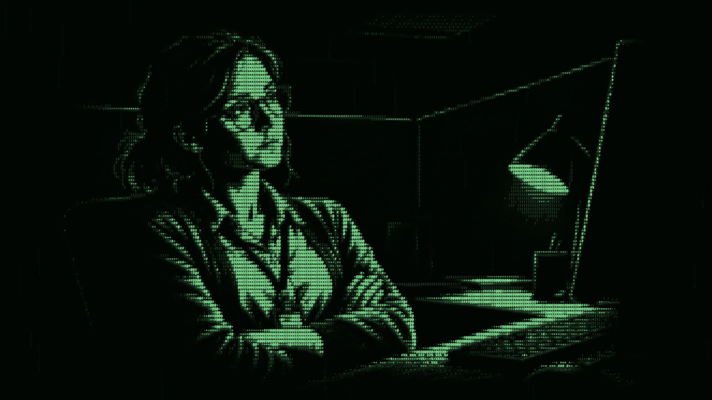

You may completely disagree with the idea of AI anything, on the basis that it's put a lot of people out of work, completely unravelled the creative industry, and is currently propping up the world's faltering economy. I think that's a perfectly valid opinion to have.

But take that fight up with the people who can actually legislate on the issue. Here in the UK, the government spent the best part of two years consulting on AI and copyright, and in March this year confirmed it has no immediate plans to change copyright law at all.

That's where the real decisions are being made. Not with Joe Indie, who just wanted to make his own Pokémon clone, but with the people making the laws.

## Unleashing creativity

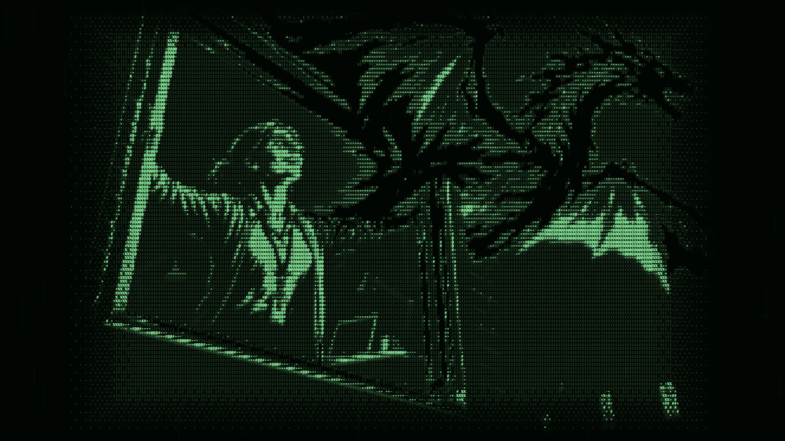

Finally, I'd argue AI coding has made it easier than ever for creative people to unleash their ideas into the world.

Sometimes I have dreams that feel so real and detailed that I wish I could record them to show other people. The problem is that device doesn't exist. But if I could go out tomorrow and buy a Sega Dream Recorder, would I? You bet I would.

## The elephant in the room

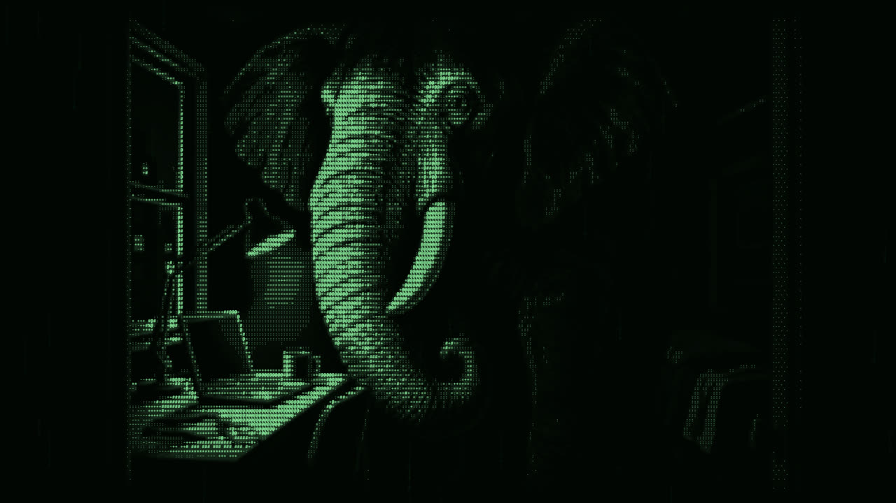

There's a good amount of research to suggest cognitive atrophy is a real thing. Outsourcing our thinking to machines can have a genuine, detrimental effect on our ability to think critically and solve problems.

In 2025, researchers at MIT's Media Lab hooked 54 people up to EEG headsets while they wrote essays. The group using ChatGPT showed the weakest brain connectivity of everyone, and many of them struggled to quote from essays they'd written just minutes earlier. They called it cognitive debt.

But this isn't really anything new. It's been slowly happening since the rise of luxury technologies, the gadgets we buy that aren't essential for survival but are designed to distract us from the sometimes difficult reality of life.

I'm not arguing that AI hasn't let us outsource our thinking in some ways. It has. But in others, it's opened up avenues for learning that previously felt Herculean.

And it's not just me saying that either. Harvard ran a study with 194 physics students. Students using an AI tutor built to guide them through problems, rather than just hand over answers, learned more than twice as much as students in a really good classroom lesson, in less time.

Another study of nearly 1,000 high school maths students in Turkey found something really interesting. Students who used plain ChatGPT as a crutch did 17% worse in their exams once it was taken away. But students using a version designed to tutor rather than answer largely avoided that drop. So the tool isn't the problem. How you use it is.

## My pathfinding nightmare

Let me give you a personal example. I'm not the most amazing at maths. Algebra in particular I've always found quite difficult. So you can imagine how I felt when I first tried to add pathfinding and line of sight logic into my mobile game, Blood in the Sand. Truth be told, I had literally no idea where to start.

So what would you do in that situation? In the past, it could've taken me weeks or months of learning, theory and practice to start piecing it all together. It probably wouldn't have worked very well, and it would've been incredibly stressful the whole time.

But what if I could have an AI model make a plan, run me through the maths line by line, and let me interrogate what's happening in real time? That's exactly the kind of guided learning those studies are talking about.

You could argue that by doing it the hard way, I'd be more likely to remember it going forward. But long before AI coding, I'd frequently forget syntax, algorithms, best practices and software development principles. You know, the important stuff you use day to day. Simply because nobody can keep the Library of Alexandria inside their head.

## The case for the defence

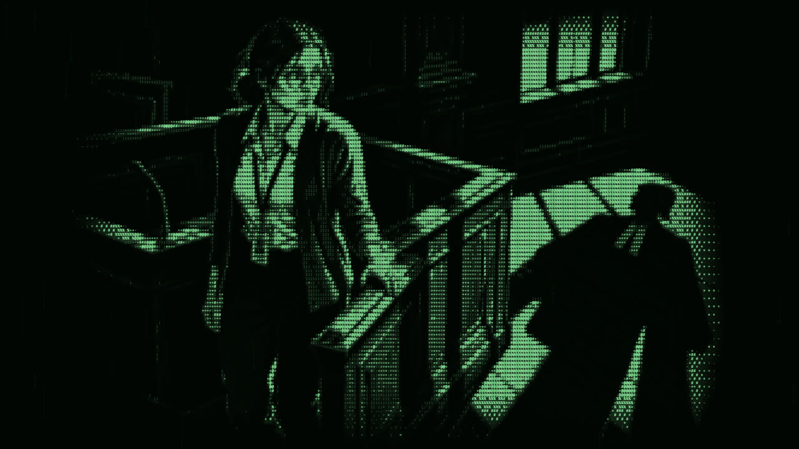

AI has lowered the bar to entry for game development, and the slop we're seeing is a quality gate problem, not an AI problem. Like CGI, you only notice it when it's done badly.

It's giving solo developers a fighting chance against a corporatised, $300 million industry, just like the bedroom coders of the 80s and 90s. The genie is already out of the bottle, and the big studios are already all in.

Most of what people hate is the brazen, extractive way it's being used, not the tool itself. And used properly, it can actually help us learn and create things we never could have before.

Am I saying AI in game development is all sunshine and rainbows? Absolutely not. There's a case for the prosecution too, and believe me, there's plenty to talk about.

## Sources

- [How many games were released in 2025? (How To Market A Game)](https://howtomarketagame.com/2026/01/08/how-many-games-were-released-in-2025/)
- [Over 18,000 games released on Steam in 2025, but half have fewer than 10 reviews (MP1st, via SteamDB)](https://mp1st.com/news/18k-games-released-steam-2025-half-have-10-reviews)
- [Over 18,000 games have come to Steam in 2025 (KitGuru)](https://www.kitguru.net/gaming/matthew-wilson/over-18000-games-have-come-to-steam-in-2025/)
- [Steam games disclosing generative AI use 'are up 800%' this year (VGC, via Totally Human)](https://www.videogameschronicle.com/news/steam-games-disclosing-generative-ai-use-are-up-800-this-year/)
- [Valve opens the floodgates to allow more AI-based games on Steam (MP1st)](https://mp1st.com/news/valve-opens-the-floodgates-to-allow-more-ai-based-games-on-steam)
- ["We see ourselves as the one and only true alternative to Steam" (PCGamesInsider)](https://www.pcgamesinsider.biz/interviews-and-opinion/67293/we-see-ourselves-as-the-one-and-only-true-alternative-to-steam/)
- [GOG now using AI generated images on their store (GamingOnLinux)](https://gamingonlinux.com/2026/01/gog-now-using-ai-generated-images-on-their-store)
- [What do you mean, no CGI? (VFX Voice)](https://vfxvoice.com/what-do-you-mean-no-cgi/)
- [RollerCoaster Tycoon (Wikipedia)](https://en.wikipedia.org/wiki/RollerCoaster_Tycoon_%28video_game%29)
- [The code of Chris Sawyer (PCGamesN)](https://pcgamesn.com/rollercoaster-tycoon/code-chris-sawyer)
- [Big-budget game development is not sustainable (Aftermath)](https://aftermath.site/big-budget-game-development-is-not-sustainable/)
- [Report: AAA games now cost $300+ million (Dark Horizons)](https://www.darkhorizons.com/?p=190830)
- [Stardew Valley creator almost canceled the game (GameRant via OpenCritic)](https://opencritic.com/news/34419/stardew-valley-creator-almost-canceled-the-game)
- [Stack Overflow Developer Survey 2025: AI](https://survey.stackoverflow.co/2025/ai)
- [Report finds that 94% of studios use AI (VGC, Vivrato VAIA Report)](https://www.videogameschronicle.com/news/report-finds-that-94-of-studios-use-ai-but-more-than-half-say-it-isnt-deeply-embedded-into-production/)
- [GDC 2026 State of the Game Industry](https://gdconf.com/article/gdc-2026-state-of-the-game-industry-reveals-impact-of-layoffs-generative-ai-and-more/)
- [GDC reports one-third of game workers are using GenAI (Wccftech)](https://wccftech.com/ai-is-theft-i-have-to-use-it-otherwise-ill-get-fired-gdc-reports-one-third-of-game-workers-are-using-genai-for-daily-tasks//amp/)
- [Fearing AI copycats, indie developers pull public demos (Inven Global)](https://www.invenglobal.com/articles/27321/fearing-ai-copycats-indie-developers-pull-public-demos)
- [UK Government response on AI, copyright and the creative industries (Berry Smith)](https://www.berrysmith.com/news/report-on-ai-copyright-and-the-creative-industries-uk-government-response/)
- [Your Brain on ChatGPT (MIT Media Lab)](https://www.media.mit.edu/publications/your-brain-on-chatgpt/)
- [AI tutoring outperforms in-class active learning (Scientific Reports)](https://www.nature.com/articles/s41598-025-97652-6)
- [Generative AI without guardrails can harm learning (PNAS, via IDEAS/RePEc)](https://ideas.repec.org/a/nas/journl/v122y2025pe2422633122.html)
- [More than 19,000 games launched on Steam this year—but almost half have fewer than 10 reviews (PC Gamer)](https://www.pcgamer.com/gaming-industry/more-than-19-000-games-launched-on-steam-this-year-but-almost-half-have-fewer-than-10-reviews/)
- [Top Gun: Maverick Has 2,400 VFX Shots, Oscar Bakeoff Reveals (The Hollywood Reporter)](https://www.hollywoodreporter.com/movies/movie-news/top-gun-maverick-had-vfx-oscar-bakeoff-1235300245/)
- ['We’re not planning on making absolute statements in either direction,' GOG boss says about generative AI, leading supporters to make some absolute statements in one very specific direction: 'Absolutely terrible response' (PC Gamer)](https://www.pcgamer.com/software/ai/were-not-planning-on-making-absolute-statements-in-either-direction-gog-boss-says-about-generative-ai-leading-supporters-to-make-some-absolute-statements-in-one-very-specific-direction-absolutely-terrible-response/)
