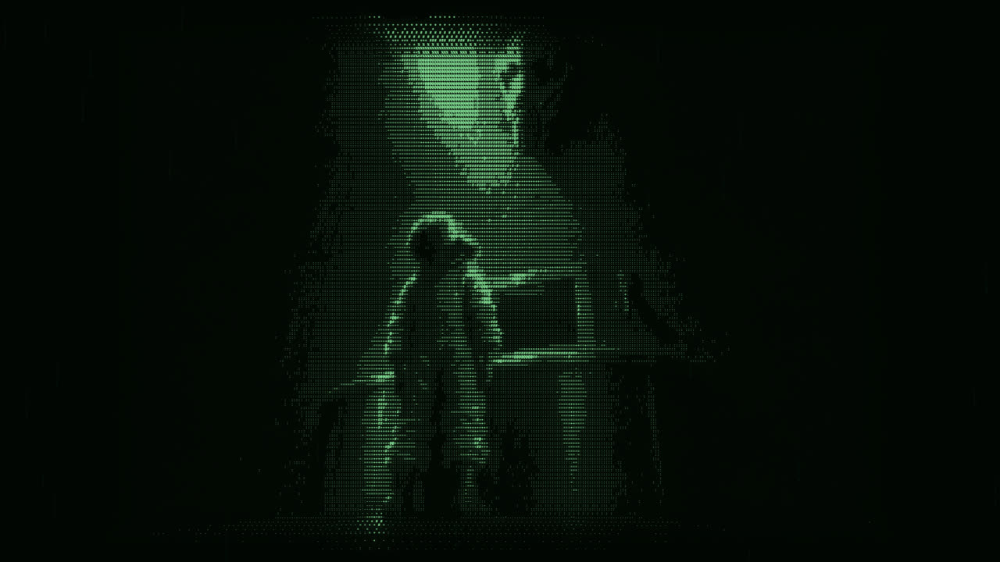
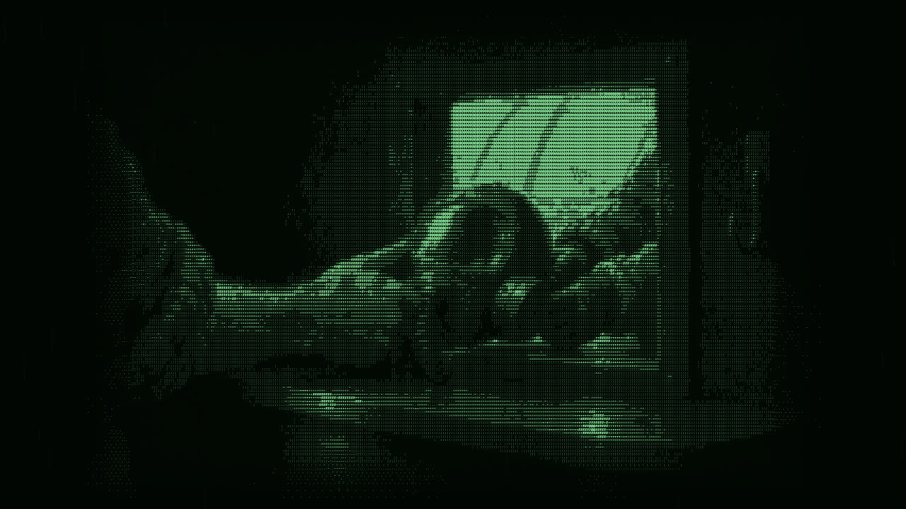
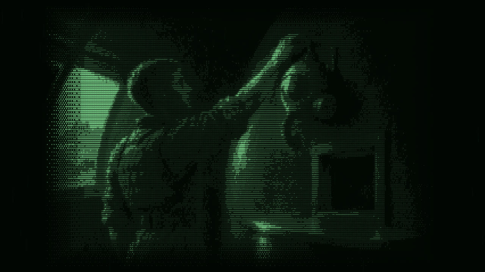
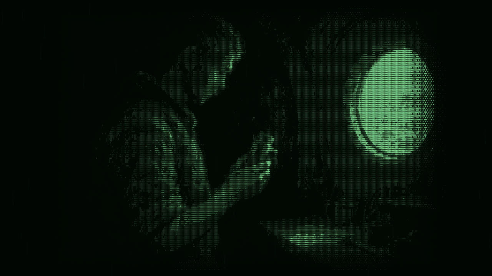
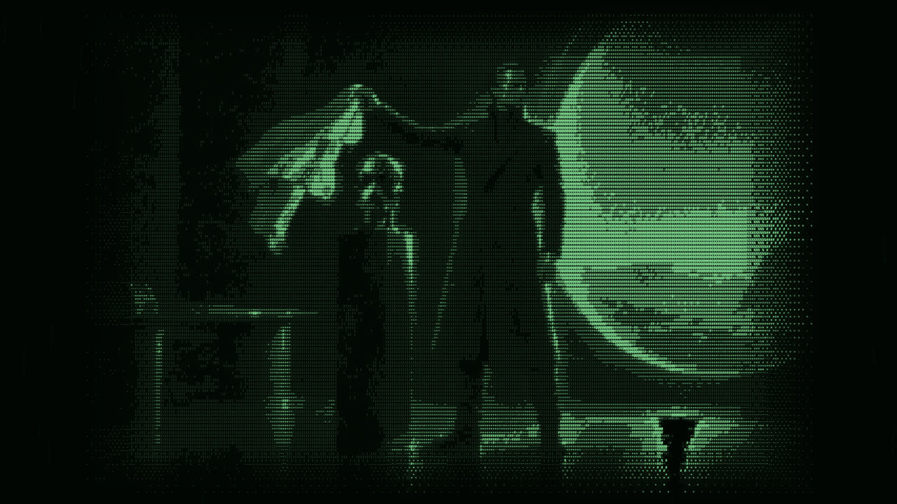
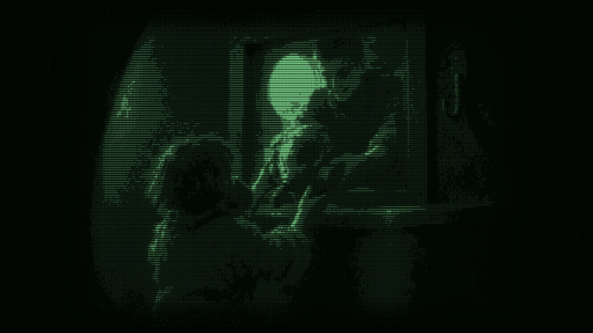

Mobile games sure do suck, huh? It seems anywhere you look there's ads, deceptively placed buttons and packs of gems that don't quite give you enough to pay for that next cosmetic upgrade. PC games don't seem to suffer from this problem anywhere near the scale of mobile, so have you ever thought about why that is?

## Good intentions

To find out, let's make a mobile game. A good one. No ads, no gems, no energy timers, you pay once and it's yours. By the end, that same game will be nagging you to log in every day and trying to sell you a $100 pack of gems.

How on earth could that happen? Well, the kicker is that every single decision we make along the way is going to make perfect sense.

There's one term worth explaining before we start, and that's a northstar metric. This essentially means a single data point you use to judge how effective a given model is.

For example, the northstar metric for a theme park might be customers per day, number of attraction riders per hour, or even average spend per guest. Keep an eye on this one, because every time we change how our game makes money, the northstar changes, and the game changes with it.

## One off purchases

Let's start with the fair option, and the same one you'd use on PC: the one off purchase. You pay once, the game is yours, and everybody's happy. So we stick our game on the app store for $4.99 and wait for the money to roll in.

Our northstar metric here is landing page conversion rate, that is, the percentage of people who land on our app store page that then go on to make a purchase. Both Apple and Google let you A/B test your store page to see which copy and assets convert at the highest rate, and you can even build specific listing pages for different languages.

Conversion rates will vary wildly depending on genre and star power, and there's not much public data for paid mobile games. But developers sharing their Steam numbers suggest a full price game converts around 2 to 5% of visitors after launch, so for our game let's say 2%.

Imagine 100,000 people visit our store page. At 2% that's 2,000 sales at $4.99, or just under $10,000. After the app store takes its 15%, we're left with about $8,500. Not bad. But we only get that money once, and 98,000 people just walked away.

But our game isn't sitting next to other $4.99 games, it's sitting next to thousands of free ones. Even Nintendo couldn't make this work. Super Mario Run was free to download with a one off $9.99 fee to unlock the full game, and Nintendo said it hadn't reached an acceptable profit point.

Those are Nintendo's own words, from their financial results briefing in October 2017. Meanwhile Fire Emblem Heroes, which was free to play, made more money with less than a tenth of the downloads. Sensor Tower estimated Fire Emblem Heroes made $295 million in its first year, against $56 million for Super Mario Run.

If Mario can't get people to pay up front, what hope do we have? It's why so many of the paid games you'll find on mobile are PC ports, where mobile is often seen as a secondary market. If we're going to make a living from this, we need to do something about that price tag.

So what do we do? We obviously go and make the game free. Suddenly those 98,000 people have no reason to say no, and we just need another way to pay the bills.

## Ads

Let's turn our attention to perhaps one of the most important and contentious forms of monetisation for mobile games, ads. If you've ever downloaded and played a mobile game, I can almost guarantee at some point you've had to sit through some sort of advertisement to continue playing, or to get in-game bonuses you can use.

So what's the whole deal with that then? The economics of ads might surprise you somewhat. Ads don't actually pay that well, but there's a good reason why they've become a problem.

Let's talk about our new northstar metric to shed some light on it. Can you guess what it is? If you said watch-time or number of ads viewed, you're on the money. Much like YouTube, revenue in ad-supported games is approximated per 1,000 views.

Global ranges for ads are between 8 and 18 dollars for video ads, 2.50 to 5 for interstitial ads (the ones that take up a full page), and between 20 and 80 cents for banner ads.

Imagine our game has 10,000 daily players and each player sees four ads at $5 per 1,000. We'd make about $200 a day, or $6,000 a month. That's pretty good for a solo developer. But say the game takes off and we hire a team, suddenly that money doesn't go very far.

And therein lies the rub. Ads don't tend to scale too well with team size. For small teams and solo developers, ad income can sustain a small business with proper care, but now we've got wages to pay there's an issue.

Players can only tolerate so many ads before it seriously detracts from the player experience. We're then left with a choice: either stop putting more ads into the game, or worsen the player experience and maximise profits.

## Subscriptions

So ads have a ceiling, and players will only sit through so many before they walk away. What if instead of chasing tiny amounts of ad money, you could get players to pay you a fixed amount every single month?

Obviously I've just described a subscription, and on paper it's lovely. You get predictable income, and you can actually plan the next year of your studio.

Now you might struggle to name a mobile game with a subscription, and for good reason, they're a much smaller slice of the pie in games compared to other apps. Where you'll usually find them is dressed up as VIP memberships that drop you a few gems a day, or as battle passes.

A battle pass isn't always technically a subscription, but if a new one turns up every season and you buy every one of them, you tell me what the difference is. So can you guess the northstar metric? It's retention rate, the percentage of players who stick around over time.

Imagine you have 300 subscribers paying $4.99 a month. That's just under $1,500 a month, not bad. Now imagine you lose 20% of them every month. Six months later you're down to fewer than 80 subscribers and making less than $400.

Big studios get an extra nudge from the app stores here too. Apple's standard cut of a subscription is 30%, dropping to 15% once a subscriber has been paying for a year. If you're a small developer you'll usually pay 15% from day one, through what Apple calls the App Store Small Business Program. But that shows you just how much the platforms value retention.

So why aren't our mobile games filled with subscriptions? The big reason is that retention is very hard. The median mobile game keeps around 4% of its players after a week, and roughly 1% after a month.

When your income depends on people coming back, you stop asking "is my game fun?" and start asking "how do I get them to open it tomorrow?" That's where daily login rewards, streaks and season rewards that vanish if you don't finish them in time come from.

Duolingo isn't a game, but it's the perfect example. They've said learners who reach a 7 day streak are 3.6 times more likely to finish their course, and their team credits loss aversion for the jump in retention at that point. We hate losing something far more than we enjoy gaining it.

Before long you aren't opening the game because you want to play, you're opening it because you don't want to lose your streak. I tried to keep a Duolingo streak going for over a year, and by the end I wasn't even learning anything. I was simply logging in and doing the fastest lesson to stop me losing it.

But subscriptions still have a ceiling of their own that's not always obvious to developers. The player who would've happily spent $500 on your game pays the same $4.99 as everyone else, and if you are in the business of making money, why leave that on the table?

## Micro-transactions

Which brings us to the big one. What if you stopped charging everyone the same price? The northstar metric here is average purchase volume per customer, which you'll often see called ARPPU, or average revenue per paying user. Notice the word paying in there, because almost nobody does.

In 2025, a mobile advertising company called Moloco looked at two years of data from 100 of the biggest mobile game advertisers, covering around 4 billion installs. They found that the top 5% of payers generated nearly half of all in-app purchase revenue.

But it gets more extreme than that. The biggest spenders on iPhone in the US, just 0.02% of global installs, brought in 20% of global mobile game revenue. That's 2 in every 10,000 installs. The industry calls these players whales, a term borrowed from casinos, which should tell you everything you need to know.

Let's go back to our ad example. At $5 per 1,000 views, a single ad is worth half a cent. Now imagine one player buys a $100 pack of gems. Even after the app store takes its 15%, you're left with $85, the same as 17,000 ads. The player watching four ads a day would need more than eleven years to earn you what that whale did in a few seconds.

There are two more terms worth knowing here. LTV stands for lifetime value, that's how much an average player spends over their lifetime on the game. And CAC is customer acquisition cost, the total cost of sales and marketing divided by the number of customers.

If a player is worth more to you than they cost to acquire, you can just keep buying more players. Whales push your LTV up, so you can outbid everyone else on advertising, which gets you more players, and more whales. It's like some freakishly fishy ouroboros consuming itself, and marketing bros call this the flywheel.

So who are these whales? You might picture a bored Elon Musk type character, but the research on loot boxes paints an altogether much sadder picture. Researchers in the UK pulled together survey data from nearly 8,000 loot box buyers and found the top 5% of spenders made up half of the revenue.

That study came out of the University of Plymouth, and the paper's actually called 'Are high-spending whales wealthy gamers or problem gamblers?'. Those top 5% were spending over $100 a month, and around a third of them met the criteria for problem gambling.

And there was no real link between how much people spent and how much they earned. The conclusion I draw from that is that it's less about discretionary income, and more about certain people having behaviours that are more prone to being hijacked by these loot box systems.

It does make me think about the situations those players are in where they feel compelled to spend such gross amounts of money on these games. And that's the uncomfortable part, nobody had to be a villain for this to happen.

Once spend per customer is your northstar, the design of your game starts to change. Friction stops being a problem to fix and becomes a product you can sell. An energy timer that stops you playing, and a button to skip it. A level that's just a bit too hard, and a booster to get you through it.

And remember those packs of gems that don't quite give you enough for the thing you want? The leftovers are sat there nudging you to top up. In 2025, European consumer regulators published guidelines saying games should show real money prices and shouldn't force you to buy currency you don't want.

That same year, Genshin Impact's publisher agreed to pay $20 million to settle a case with the FTC, which accused it of obscuring the real cost of its loot boxes, among a bunch of other stuff. The FTC's own words were that it sold loot boxes that obscured real costs and misled all players about the odds of getting prizes.

Now before I get too high and mighty, Blood in the Sand has micro-transactions too. They're the only way it makes money. There are no ads, no subscriptions, and everything in the game can be unlocked just by playing it.

You're more than welcome to judge me for having a small amount of micro-transactions in my game. I essentially made a call to choose this over ads, as personally I can't stand mobile games with ads. And being the biggest player of my own game, I don't want to watch ads to play it.

I don't think micro-transactions are evil in themselves, but there's a question every developer should ask. Are you selling something players actually want, or are you selling them the fix to a problem you created on purpose?

## Where our game ended up

Let's take a look at how our game ended up. We started with a fair game you pay for once. We made it free because almost nobody would buy it, then we added ads to pay the bills.

We added streaks to keep players coming back, and we added a shop to catch the few who'll spend big. And at no point did anyone sit in a room and decide to make a worse game. Every single step made sense when taken as an independent decision.

So why not just go back to charging up front? Well, Mario already showed us how that goes, and even PC is drifting the other way. 20 years ago a completely free game on PC was quite a rarity, now they're everywhere. I just don't think we're going back to the good old days of the late noughties.

But even then, why doesn't the PC market suffer from this anywhere near as much? Think about when the money changes hands. Most of the time on PC, the sale is over before you've even started playing, and the game just has to be worth what you paid for it.

On mobile, the sale never ends. Every level, every timer and every pop-up is another chance to sell you something. On PC the sale happens at the store. On mobile, the sale is the game.

So next time something in a mobile game annoys you, ask yourself which number that annoyance is helping. And if you're an indie developer, choose your northstar carefully, because if you're not careful, it'll end up designing your game for you.

I'd rather you judge me on my actions and not my words. Blood in the Sand is out now on iOS and Google Play, with quick two minute PvP gladiator fights, so you can see for yourself if you think my pricing model is fair.

## Sources

- [Super Mario Run profit (MacRumors)](https://macrumors.com/2017/10/31/super-mario-run-acceptable-profit)
- [Fire Emblem Heroes vs Super Mario Run (Gamereactor)](https://www.gamereactor.eu/fire-emblem-heroes-is-more-profitable-than-super-mario-run/)
- [Ad rate ranges from Playwire (via Playio)](https://blog.playio.co/mobile-game-ad-revenue-calculator)
- [Subscriptions' share of game revenue (Game Dev Reports)](https://gamedevreports.substack.com/p/weekly-gaming-reports-recap-june-e95)
- [Apple and Google Play fees (Magora)](https://magora-systems.com/app-store-small-business-program/)
- [2026 Mobile and PC Gaming Benchmarks from GameAnalytics (via InvestGame)](https://investgame.net/wp-content/uploads/2026/01/2026-01-27-2026-mobile-pc-benchmarks_compressed.pdf)
- [How the Duolingo streak builds habit (Duolingo)](https://blog.duolingo.com/how-duolingo-streak-builds-habit)
- [Loss aversion and the seven day streak (Lenny's Podcast summary)](https://podcasts-distilled-hugo-content.pages.dev/lennys-podcast-product-career-growth/behind-the-product-duolingo-streaks-jackson-shuttleworth-group-pm-retention-team/)
- [Moloco research press release (Business Wire)](https://www.businesswire.com/news/home/20250415586904/en)
- [2025 State of Mobile Gaming from Moloco (Game Industry Library)](https://gameindustrylibrary.com/documents/state-of-mobile-gaming-2025)
- [Are high-spending whales wealthy gamers or problem gamblers? (University of Plymouth)](https://pearl.plymouth.ac.uk/handle/10026.1/17377)
- [Loot boxes and problem gambling (University of Plymouth)](https://www.plymouth.ac.uk/news/research-shows-links-between-loot-boxes-and-problem-gaming)
- [EU virtual currency principles (Bird & Bird)](https://www.twobirds.com/en/insights/2025/global/regulatory-spotlight-virtual-currency-vs-consumer-law-part-2)
- [Genshin Impact settlement (FTC)](https://www.ftc.gov/node/87268)
- [Steam store page conversion benchmarks (Steam Page Analyzer)](https://www.steampageanalyzer.com/blog/steam-store-page-conversion-benchmarks)
- [Secondary analysis of loot box data: Are high-spending "whales" wealthy gamers or problem gamblers? (Addictive Behaviors (Elsevier), Close, Spicer, Nicklin, Uther, Lloyd & Lloyd)](https://www.sciencedirect.com/science/article/abs/pii/S0306460321000368)
- [Six Months Financial Results Briefing for Fiscal Year Ending March 2018 (Nintendo Co., Ltd. (President Tatsumi Kimishima))](https://www.nintendo.co.jp/ir/pdf/2017/171031_2e.pdf)
- [Genshin Impact Game Developer Will be Banned from Selling Lootboxes to Teens Under 16 without Parental Consent, Pay a $20 Million Fine to Settle FTC Charges (US Federal Trade Commission)](https://www.ftc.gov/news-events/news/press-releases/2025/01/genshin-impact-game-developer-will-be-banned-selling-lootboxes-teens-under-16-without-parental)
- [Sensor Tower Data Says 'Fire Emblem Heroes' Made Over $200 Million More Than 'Super Mario Run' (TouchArcade)](https://toucharcade.com/2018/02/20/sensortower-data-says-fire-emblem-heroes-made-over-200-million-more-than-super-mario-run/)
- [App Store Small Business Program - Apple Developer](https://developer.apple.com/app-store/small-business-program/)
