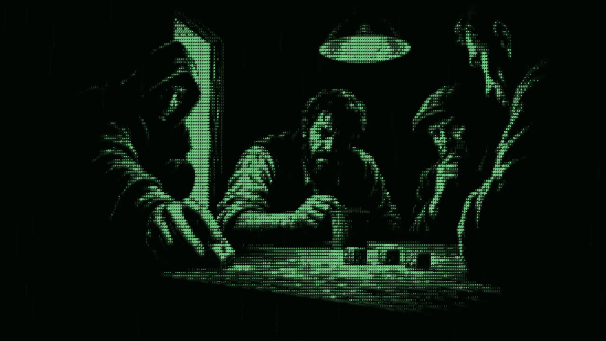

Have you ever wondered why some of your favourite online games contain tons of cheaters? It comes down to how the game communicates, and how hackers exploit that.

## Trusting every player

It's first worth understanding the three main ways clients talk to each other. And by clients I mean the device running your game.

Client broadcast is all about peer to peer. Almost any co-op or local LAN game will use this approach, and what this means is that all devices are treated as equal. Let's imagine we have a game consisting of four players. If that game used client broadcast, each player would broadcast their movements and actions to each of the other players.

This is very simple and easy to understand. It also means you can play with friends without the need for an always on game server. Local co-op games adopt this approach in almost all circumstances, and so do many non-competitive games.

But client broadcast is considered the weakest approach to security you could implement in a game. That's because you're assuming that each client in the game is playing fairly and will abide by the rules. Events sent by each client are treated as fact, so it's entirely possible for a client to send something that wouldn't be allowed by the rules of the game.

For example, take our four player game from earlier. What's stopping a client from immediately sending an event to say it has defeated the other three players? Many game developers don't consider this as a possibility, and as such don't write rules against it happening. If the game is non-competitive it doesn't really matter, as the only thing you can ruin is your own game experience. Which is why most developers don't try to remedy the issue.

Let's increase the security of our game a little and use the client host approach. Here, one player takes charge of a game and all the other players send their events to that host. The host then simulates what should happen and sends the results back out to all players in the game.

This is more secure because we've now introduced a host that's responsible for enforcing the rules of the game. If one player starts sending bogus events, the host should drop or ignore them and carry on sending the correct events to every other player.

However, this has a trade-off. Because somebody has to be picked as the host, it can cause issues with latency and performance that may be unacceptable depending on the game. Many older strategy games used this approach back when it was comparatively very expensive to run your own game servers. So some older players may be familiar with "Host disconnected from match" errors.

This approach isn't foolproof either, because what if the person who wants to cheat is the host? Well, then they essentially have the ability to dictate the entire game, as they control what gets sent to the other players.

## The server decides

Moving up to the highest level of security in multiplayer games, there's server authority. This is having a separate game server decide what is and isn't possible for all players in a game.

If a developer uses this approach, each client sends actions saying what it would like to do to a centralised game server. This server is actively simulating the entire game in code as it receives the actions from players. It then calculates what should happen given the state of the game right before, and sends that back out to all clients once it's computed.

This almost always shuts down rogue players, since they no longer have the ability to influence messages to other clients in the game themselves. And any developer who takes cheating seriously will build a system into the game server to deny actions it doesn't deem valid.

To illustrate, players don't typically send messages like "I move 20 units to the left". They'll send an action or intention, so "I want to move left". The game server then calculates whether they can, and indeed by how much.

To use a more concrete example, in a game like League of Legends, when you want to use an ability and press Q, W, E or R, an event is sent to the match server to say "I have pressed Q". The match server then figures out two things. First, was it possible for you to use this ability at the current time? And second, does anything happen as a result?

A question you might ask is why you'd ever choose a weaker level of security and not just use a game server every time. The answer is surprisingly simple. By avoiding a game server, a developer avoids two significant issues: complexity and money.

Servers cost money, and they need you to know how to simulate games outside of the client. This massively increases costs for development studios, which is why game servers are often only used when there's a competitive element to a game.

This is also why I use game servers for my own competitive mobile game, Blood in the Sand. The urge for players to try cheating when real in-game currency is on the line is a risk I'm not willing to take.

In games where you aren't as bothered about cheating, either because the game isn't competitive or there are no rewards for doing it, not using a game server is often the most pragmatic way to let people play. And a large benefit of not using one is that your game doesn't need a constant connection for you to play.
