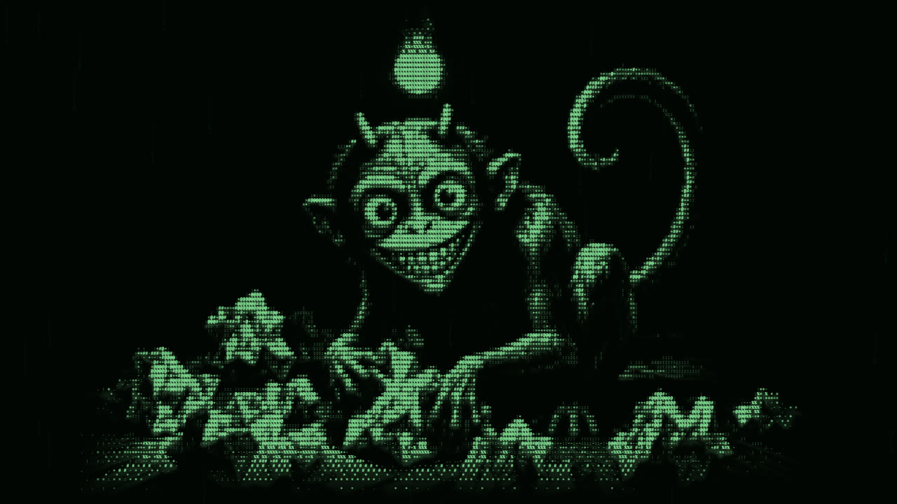
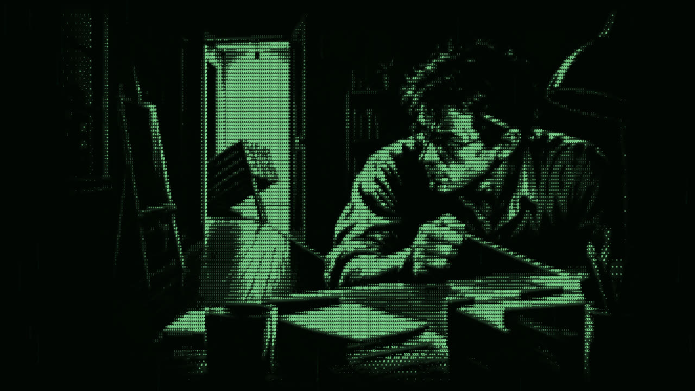
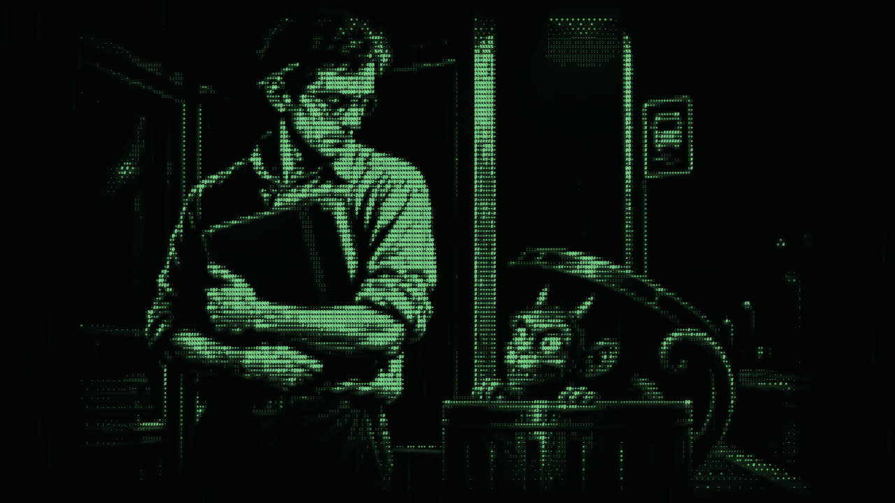
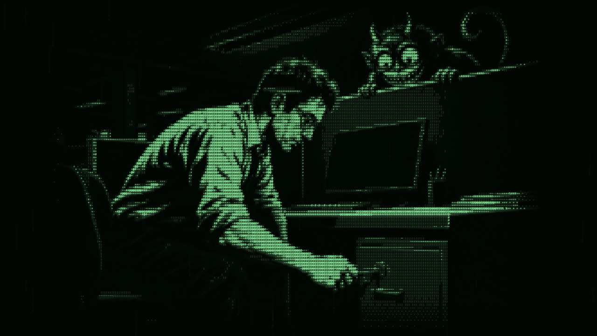
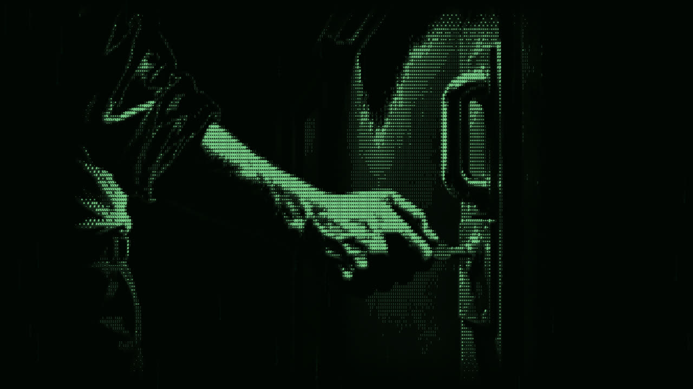
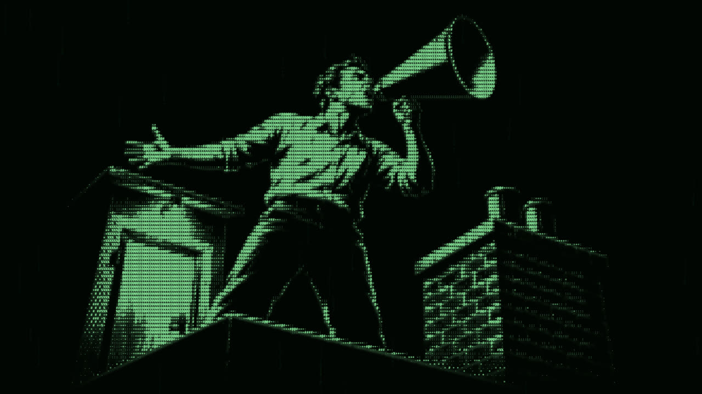

It's no secret that PC and mobile game stores are filling up with a lot of aptly named Slopware. But have you also noticed the recent rise in copycat games?

That's when one unscrupulous developer downloads a copy of a new or upcoming title, clones it with AI, swaps out a few bits here and there, or makes no changes at all, and publishes it onto the same store as you.

## The copycat problem

And this isn't just a handful of unlucky developers either. Nearly 23,000 games have been released on Steam this year alone, and Valve have now openly admitted that Steam has a cloning problem.

At least one developer has reported being told to pay up or have their game cloned with AI and released first. And Valve's view, from a developer conference in South Korea, is that the solution is in the hands of individual developers and not Valve itself.

But what if you could fight back? I'm an indie game developer myself, with over a decade of experience in the software industry, and there are some things in this list you must do now to help protect yourself against AI copycat developers. Some of this advice is the complete opposite of the popular conventions you may have been told.

## Setting traps

I want you to think of yourself as Kevin McCallister from Home Alone. You're by yourself over Christmas with a whole house full of presents, but two mean spirited robbers want to take them all away. So what do you do? Well, you lay traps of course.

Now anti-piracy measures aren't new, and there are well documented games from the past couple of decades that have taken rather humorous approaches to dealing with people pirating their games. In Game Dev Tycoon, for example, using a pirated copy of the game would make it so that your own in-game titles got pirated so much you'd eventually stop making any money whatsoever.

Even better, the developers uploaded that cracked version to torrent sites themselves. Greenheart Games said they put it out minutes after opening their store, and after its first day on sale only 214 out of over 3,300 players had actually paid for the game.

But obviously we can't do something like that. We're not here to set a trap for the player, but for the copycat themselves. And for this we can borrow a technique that goes back almost a century, to the map making industry.

Accurate mapping has always been a difficult and long process. So it was no surprise that when map makers published their work, it was often copied unofficially by other printers, hoping to skip all the hard work and profit from printing it in books.

As an anti-piracy measure, map makers started to add what are known as trap streets. These are fictitious roads and locations that don't exist in real life. The original mapper knew which places were fake, so anybody caught with that same place on their map must have copied the original.

One of the most famous examples is Agloe, a town that started appearing on maps of New York State nearly a hundred years ago. It didn't exist. The General Drafting Company made it up, and named it using a jumble of the initials of its director and his assistant. Sure enough, a few years later Agloe turned up on a map made by one of their biggest competitors, Rand McNally.

Closer to home, in 2001 the AA agreed to pay Ordnance Survey £20 million after it was found to have used OS maps as the source for over 500 of its own publications. Ordnance Survey said it could prove it through little hidden fingerprints in its maps that weren't obvious to either the reader or the person copying them. That's exactly what we want to do with our games.

The way you use this in your game is similar. You leave traps that don't serve much of a purpose other than to point back to your own authentic work. Maybe specific markings on some of the assets, odd little details in your level layouts or text files, or even hidden key combinations that would be hard for a copycat to spot.

One word of warning though. Don't rely on random unused lines of code as your traps. Game engines and compilers will often strip out any code that never runs, and an AI clone will usually rewrite your code anyway.

Assets, text and level data, on the other hand, tend to get copied across exactly as they are. That makes proving a copycat an open and shut case when appealing to Valve or another game store. Just make sure you document somewhere private where you left the traps.

## Mobile games

In the world of mobile games, there are a couple of fairly low lift things you can do to make it harder for copycats to take you out. The first is enabling Google Play Integrity on Android and App Attest on iOS.

This forces a check that the copy of the app talking to your servers is a real game installed from either store. As long as your server actually checks the result, if someone repackaged your game into another app, anything that talks to your servers would simply stop working.

One other thing you can do is avoid putting all of your content in the initial download. Both app stores optimise for small initial bundle sizes, and many developers stream content down after install. That naturally helps you, because anybody getting hold of the app bundle only sees about half of the picture.

It's also worth noting that if you have a Unity game, on iOS it's already compiled to native code using something called IL2CPP. That's effectively a requirement from Apple, and Unity's own documentation says IL2CPP is required for iOS and most consoles.

On Android it's technically optional. But Google Play has required 64-bit support since 2019, and Unity's older Mono option doesn't support 64-bit on Android. So if your game is on the Play Store, good news, you're almost certainly using it already. I'll explain what IL2CPP actually does further down.

## PC games

For PC it gets a little more nuanced. Again, if you have a Unity game, make sure you're selecting IL2CPP in your build settings. And if you're in Unreal, use encrypted pak files.

If you're using Godot, set an encryption key. Be warned though, in Godot that means compiling your own export templates with the key built in. It isn't just a tickbox in the settings.

Encryption by itself won't stop somebody copying your game, but it does make it harder. If you don't know what it does, simply put, your game's files are encrypted with a key so they can only be accessed if you have that key.

Ironically though, the key has to ship inside the game itself so the game can unlock its own files. So it is possible to find it, but it's a frustrating process that needs special software to do in a timely manner.

IL2CPP is slightly different to encryption. Your Unity game, written in C#, is first compiled into a format called IL, and IL2CPP then converts that into C++ and compiles it into native machine code.

The best analogy I can draw is that it's like giving someone a cake without the recipe. They can certainly try and guess the ingredients, but it takes some specialist knowledge and a lot of time.

One thing to bear in mind though. IL2CPP only protects your code, not your art, audio and other assets, which can still be pulled out of your game with freely available tools. Unity also doesn't have built in encryption for those, like Unreal and Godot do. So you'd need a plugin or your own custom loading code if you want to protect them too.

Moving away from the hard technical details, one mistake I've seen quite often is a developer uploading their whole game as a demo onto Steam, and using a flag to gate off particular bits of it.

Do not do this. You're essentially giving away your entire game code for free without realising it. And if you're releasing a demo to build interest while you finish the game, you're simply inviting somebody to swoop in and take your code.

And this isn't hypothetical either. The Steam Next Fest demo for Grapple Dog turned out to contain the entire game, four whole months before it launched. And Square Enix had to pull the Trials of Mana demo from Steam after people worked out they could use its files to play the full game.

## Multiplayer

If you're building a multiplayer game, you get a unique sort of protection from copying. That's because you can offload some of your game's logic onto a private game server, where the source code isn't available to players.

For my game Blood in the Sand, for example, all of my ranked queue code, ranked match simulation and rating system are handled on the game server, as are achievements, purchases and plenty of other things.

If someone wanted to copy my game they still could, after all nothing is sacred. But it would take many hundreds of hours of reverse engineering its behaviour from talking to the server itself. For 99% of cases, that's too much effort to bother with.

## Keep building in the open

This opinion may get me into a lot of trouble. But over the past few weeks I've seen some people screaming from the rooftops about how indie devs need to stop building in the open. It leaves us too exposed, they say, to having our IP taken away.

And then there's early access, literally gifting code to a copycat developer. To be fair, I get where they're coming from. Alliance Arts pulled their Steam Next Fest demo, and the team behind Moonlighter have said they won't run a public playtest for their next game because of AI cloning.

But the Moonlighter team said they'd had tens of thousands of people signed up for their Steam playtest, and moving it to Discord means a few hundred people at best. And I'm going to tell you why I think that's bullshit advice.

Firstly, games live and die by their community, and selling in a crowded market is hard enough as it is. Building the game is only half the battle, and developers need to keep finding new ways to promote their games to potential players.

Building in the open is actually one of the best things you can do to protect your game from theft. You've got a community of players who'll happily go in to bat for you if it does happen. And by building openly, you've got a clear trail of evidence for who built the game first.

You only have to look at what happened with Needle In A Haystack Simulator. The game went viral, and when its Steam page went live, two clones went live on the very same day.

Chris Zukowski from How To Market A Game pointed out that the original was in the lead right up until one of the copycats got a demo out and content creators started playing it. Hiding your game away doesn't stop the copycats, it just hands them the head start.

He also pointed out that Needle In A Haystack Simulator had only ever run a playtest. They were still cloned, and they got overtaken when Find The Needle put a demo out first.

Remember that copycats aren't looking to get sued or have long drawn out legal fights. They want to get in, copy, sell and get out with as little fuss as possible. By making yourself a problem that can't be ignored, you're making yourself less likely to become a target.

Lastly, please make sure you keep all of your game's code in some form of source control. If you ever end up disputing a clone, you'll have a clear, dated history to prove you made it first. And while you're at it, it's worth looking into trademarking your game's name too.

## Sources

- [Valve admits Steam has an AI slop and cloning problem (PC Gamer)](https://www.pcgamer.com/software/ai/valve-admits-steam-has-an-ai-slop-and-cloning-problem-but-says-we-dont-want-to-be-gatekeepers-telling-developers-which-tools-they-should-or-shouldnt-use/)
- [AI game clones are making indie developers afraid to show their work (GameDev.net)](https://gamedev.net/news/6550-ai-game-clones-are-making-indie-developers-afraid-to-show-their-work/)
- [AI Cloners Are Here. Are Indie Devs Cooked? (How To Market A Game)](https://howtomarketagame.com/2026/10/28/ai-cloners-are-here-are-indie-devs-cooked/)
- [Game Dev Tycoon punishes pirates with in-game piracy (Pocket-lint)](https://www.pocket-lint.com/games/news/120706-games-development-simulation-game-punishes-pirates-with-in-game-piracy)
- [Game pirates get a taste of their own medicine (NBC News)](https://www.nbcnews.com/news/amp/wbna51707821)
- [Agloe, the paper town stronger than fiction (Big Think)](https://bigthink.com/strange-maps/643-agloe-the-paper-town-stronger-than-fiction/)
- [AA map copyright dispute settled (Estates Gazette)](https://www.estatesgazette.co.uk/?p=487714)
- [Trap Streets (Cabinet Magazine)](https://cabinetmagazine.org/issues/47/bridle.php)
- [Grapple Dog Steam Next Fest demo (The Cutting Room Floor)](https://tcrf.net/Proto:Grapple_Dog/Steam_Next_Fest_Demo)
- [Square Enix removes Trials of Mana demo (DSOGaming)](https://www.dsogaming.com/news/square-enix-removes-trials-of-mana-demo-due-to-a-bypass-that-could-allow-you-to-play-the-full-game/)
- [Mono does not support ARM64 (Unity documentation)](https://docs.unity3d.com/Packages/com.unity.xr.arcore@5.1/manual/project-configuration-arcore.html)
- [Google Play 64-bit requirement (Unity Discussions)](https://discussions.unity.com/t/google-play-not-compliant-with-64-bit-despite-following-the-instructions/226704)
- ['If you can’t show your game to the world without fearing it’ll be cloned, something’s broken' says Moonlighter studio on its canceled demo (PC Gamer)](https://www.pcgamer.com/gaming-industry/if-you-cant-show-your-game-to-the-world-without-fearing-itll-be-cloned-somethings-broken-says-moonlighter-studio-on-its-canceled-demo/)
- [Valve weighs in on Next Fest AI cloning phenomenon (Game Developer)](https://www.gamedeveloper.com/pc/valve-addresses-steam-ai-cloning-problem)
- ["Pay $200 or We'll Clone Your Game with AI and Sell It First": Absurd Extortion Targeting Indie Developers Spreads (Inven Global)](https://www.invenglobal.com/articles/27359/pay-200-or-well-clone-your-game-with-ai-and-sell-it-first-absurd-extortion-targeting-indie-developers-spreads)
- [What happens when pirates play a game development simulator and then go bankrupt because of piracy? - Greenheart Games](https://www.greenheartgames.com/2013/04/29/what-happens-when-pirates-play-a-game-development-simulator-and-then-go-bankrupt-because-of-piracy/)
- [Introduction to scripting back ends • Unity Editor • Unity Docs (Unity Technologies)](https://docs.unity.com/en-us/engine/6000.6/manual/programming-environment/scripting-backends/intro)
