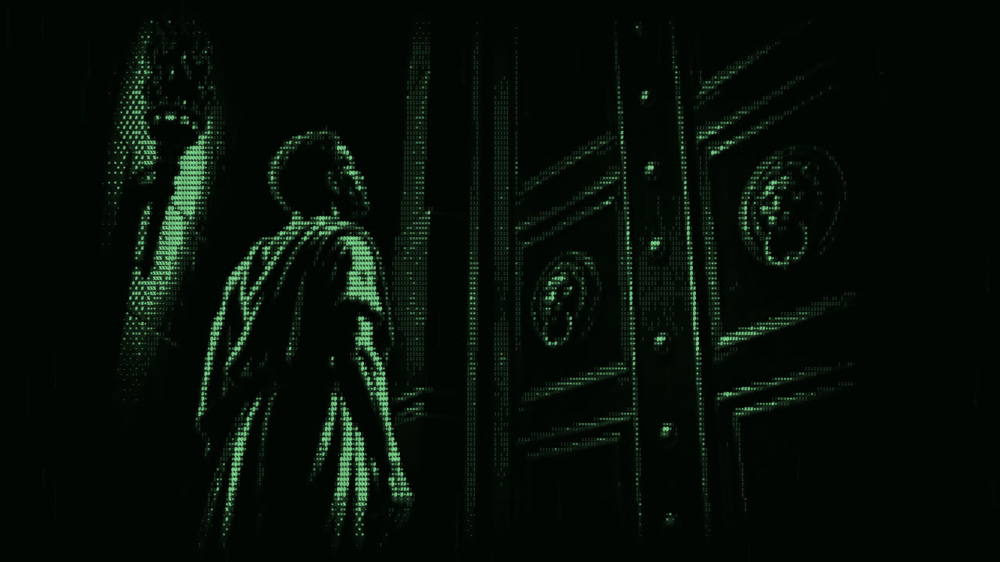
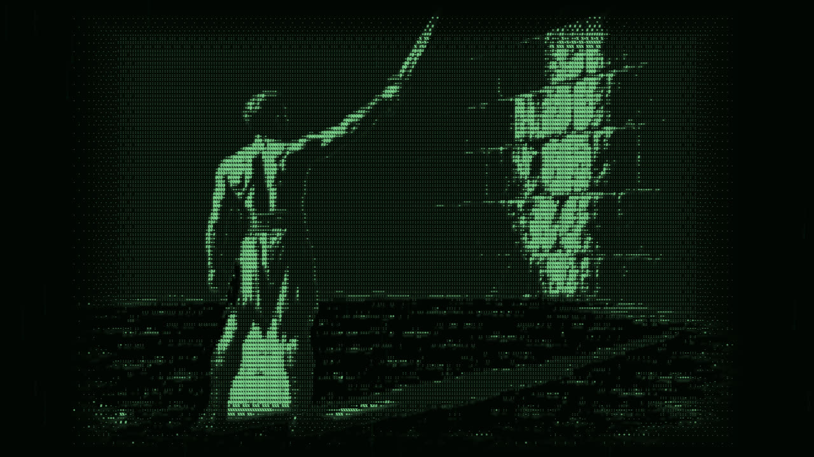
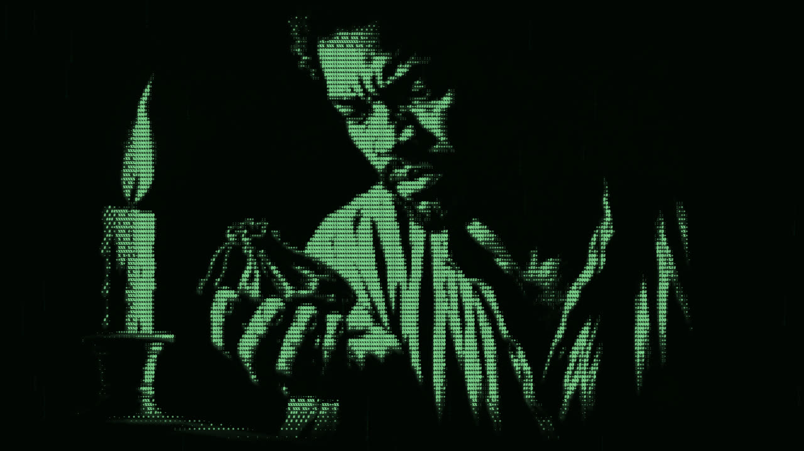
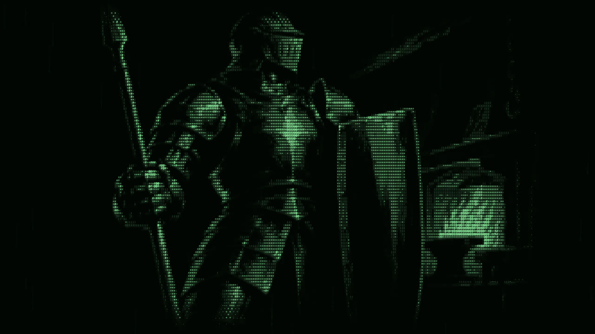
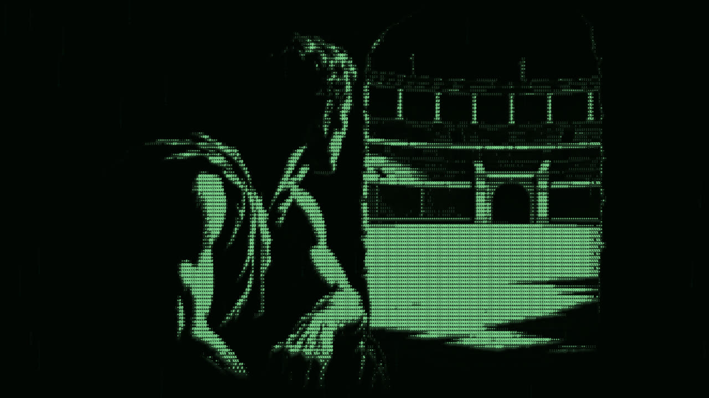
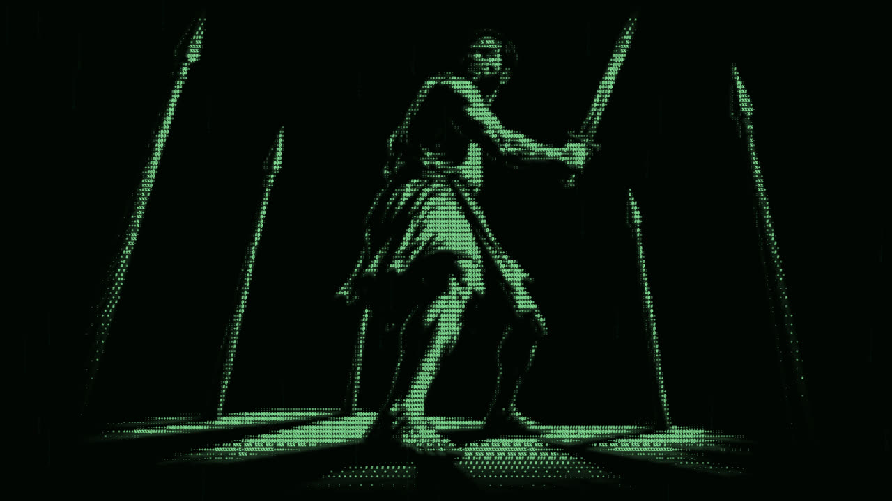

Most mobile games fail. And I'm not talking about the ones from the huge studios, I mean the ones made by small teams and indie developers like me.

As an indie developer who's built and shipped my own mobile games, I can tell you first hand that actually making the game is only the start. Getting a mobile game to succeed is a war on many fronts, and I want to go through five of them: approvals, discovery, the monolith of massive mobile game studios, the devices themselves, and the players.

## Approvals and updates

The first battle happens before a single player has even seen your game, and that's getting it approved. Every mobile game has to go through a review process with Apple and Google before it can go live, and this can take a very long time. That's especially true if your game uses permissions on the device, or has social features that let players interact with each other.

And it doesn't stop once you're approved. Any update that isn't an over the air update has to go back through that same approval process, and it can be denied for almost any reason. This isn't rare either. In Apple's latest App Store transparency report, they reviewed around 9.1 million submissions and rejected over 2 million of them. That's nearly one in four.

To give you an idea of how bad this can get, a company I once worked for couldn't update our app for iOS users for two whole months. Not because of anything new we'd added, but because of something that had existed in the app for years that Apple had only just picked up on. And they wanted us to make large changes before they'd let anything else through. Two months of not being able to fix bugs or ship anything to an entire platform.

For a big company that's painful. For an indie developer that could genuinely be the end of your game.

## Discovery

Let's say you've made it through approval and your game is live. Congratulations. Now nobody knows it exists.

One of the biggest issues for small developers is that there's no natural way for players to discover new games that actually benefits them. The App Store and Google Play do a terrible job at promoting games from smaller developers. The charts and featured spots are dominated by the same handful of massive games. And if you aren't already getting downloads, the store has no reason to show you to anyone. Which means you don't get downloads. It's a chicken and egg problem.

So naturally you turn to social media, and this is where you hit the install gap. Think about how people actually find content now. They're scrolling TikTok or YouTube, they see a clip of your game, maybe they even think it looks cool. But then they have to leave the app they're in, open the App Store, search for your game by name, and download it.

That is a huge ask for a modern audience, and most people simply won't do it. They'll just keep scrolling.

I've felt this first hand with Blood in the Sand. By the time my clips had racked up around 10,000 views in total, I'd managed to get exactly one person to download the game. And they didn't even make it past the tutorial screens.

## The monolith of studios

Now you might be thinking, fine, if people won't find my game naturally, I'll just pay for advertising. It may be tempting, but the whole system is rigged against you.

Paid advertising on mobile is dominated by massive mobile game developers churning out endless amounts of slop. These companies have optimised their games down to a science. They know exactly how much it costs them to get each player through an ad, known as the CPA or cost per acquisition. And they know exactly how much that player needs to spend for the ad to pay for itself.

They have huge budgets, tons of data, and they're bidding for the exact same ad space as you. To put that into perspective, AppsFlyer estimated that gaming apps spent around 29 billion dollars on user acquisition in 2023 alone. That's who you're up against.

Because advertising costs so much, that money has to be made back somehow, and that's where predatory pricing tactics come in. Limited time offers, energy systems that stop you playing unless you pay, loot boxes, battle passes. All designed to get players spending more so the numbers add up.

This is why every mobile game feels like it's trying to take as much money from you as possible. And as an indie developer, you're left with a pretty grim choice. Either you try to outspend companies with millions in their ad budget, which you can't, or you copy their tactics to make the maths work, which players hate.

## Device limitations

The fourth front is the device itself. On PC or console you've got a keyboard and mouse, or a controller with a dozen buttons to work with. On mobile, you essentially have two things: the touch screen and the gyroscope. This means you have to get very imaginative with how players control your game.

It's also why most mobile games are much simpler in design and often use tapping as the main control mechanism. Tap to jump, tap to attack, tap to collect. It's not that mobile developers lack ideas. It's that tapping is one of the few inputs that works reliably on a small glass screen with your thumbs covering half of it.

This is really clear when developers port existing PC games over to mobile. They often have to massively simplify the controls, or force the player into landscape mode and overlay a virtual controller on top of the game just to make it playable. And if you've ever tried playing with virtual thumbsticks, you'll know it never feels quite as good as the real thing.

## The players themselves

The last front is one I learnt the hard way, and that's understanding who mobile gamers actually are. Mobile gamers just aren't the same as console or PC gamers.

With Blood in the Sand, I made a competitive mobile arena game. On PC that sounds perfectly fine, competitive games are some of the biggest games out there. But on mobile, that's a really niche audience. According to a report from Liftoff, casual games make up nearly 87 percent of all mobile game downloads, while midcore games like mine get just over 3 percent.

Most mobile players want casual games they can chill out on the sofa with, play for five minutes on the bus, or pick up and put down whenever they like. They aren't looking to grind ranked matches or get beaten by someone who's put in way more hours than them.

That doesn't mean competitive mobile games can't work, but it does mean you're fishing in a much smaller pond. And when you combine that with everything else, it makes an already hard job even harder.

## Fighting all five at once

So that's the war on many fronts. Getting your game approved and keeping it updated, getting anyone to actually find it, and competing with massive studios who've turned advertising into a science. Then there's designing around a device that was never really built for games in the first place, and building for players who might not even want the kind of game you're making.

Any one of these on its own is tough, but as an indie developer you're fighting all five at the same time, usually with a tiny team and little to no budget. That's why so many mobile games fail. And honestly, it's why so many good ones never get seen.

Which brings me to Heroic: Blood in the Sand. It's a competitive PvP gladiator game with quick two minute fights, in 1v1, 2v2 or a six-player free-for-all, and it's out now on iOS and Google Play. And yes, I'm fully aware I'm asking you to cross the install gap right now.

## Sources

- [2025 App Store Transparency Report (Apple)](https://images.apple.com/legal/app-store/transparency/2025/)
- [AppsFlyer State of Gaming App Marketing 2024 (via GamesBeat)](https://gamesbeat.com/appsflyer-state-of-gaming-report-user-acquisition/)
- [Liftoff Casual Gaming Apps Report 2023 (via Game Dev Reports)](https://gamedevreports.substack.com/p/liftoff-casual-game-market-in-2023)
